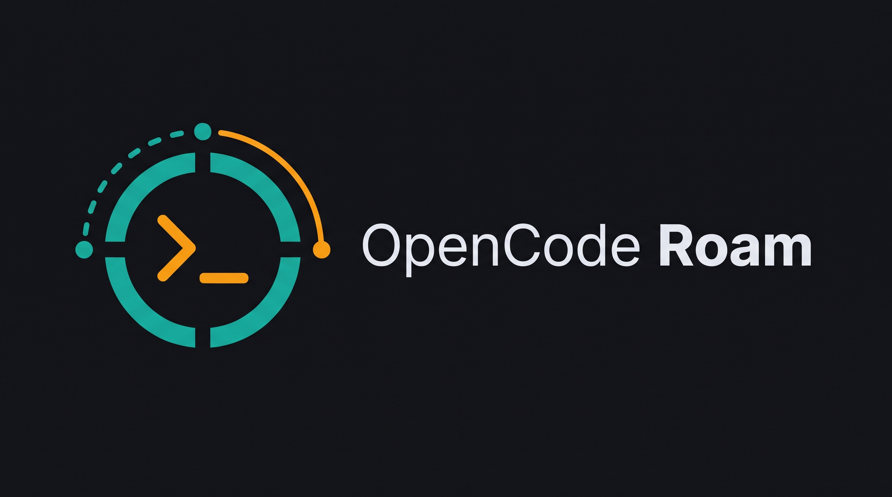
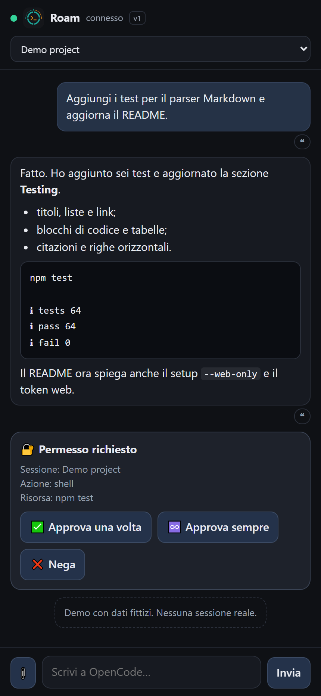
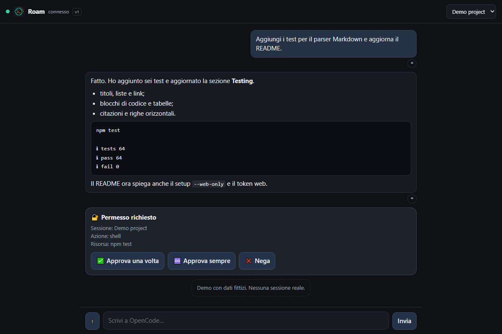
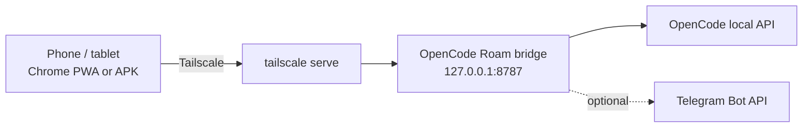
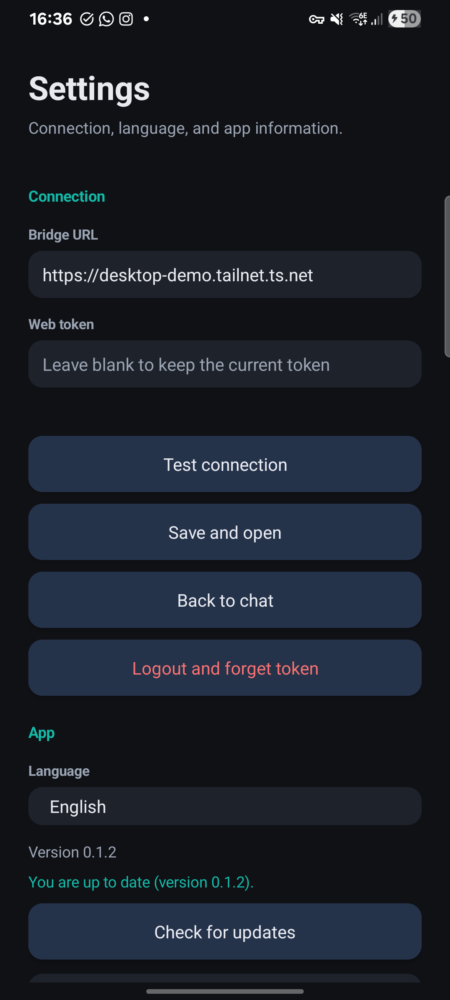
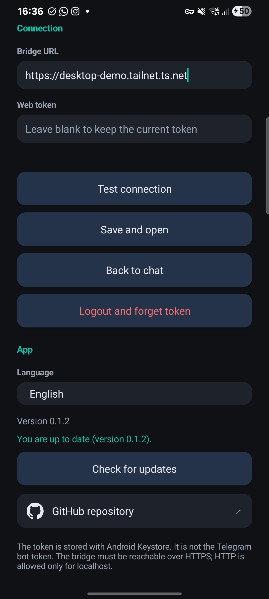

# OpenCode Roam

**Self-hosted remote access for OpenCode.** Run the bridge on your own PC and use
a private web UI/PWA from your phone, tablet, or another browser over Tailscale.
Telegram is optional: add it only if you want push notifications, commands, and
approval requests in a Telegram chat.



OpenCode Roam is an **unofficial community project**, not affiliated with,
endorsed by, or sponsored by OpenCode, Tailscale, or Telegram.

> The web UI and Android app are available in **English and Italian**. The
> language follows the system by default and can be changed in Settings. The
> interactive setup follows the system language; use `--lang en` or `--lang it`
> to override it.

## Why

OpenCode is powerful on the PC where it runs. OpenCode Roam gives you a small,
self-hosted remote control for it:

- the code, the agent, and the session stay on your machine;
- the phone is only a client;
- no account, no hosted service, no telemetry;
- access is private through your Tailscale tailnet;
- Telegram is a transport, not a requirement.

## Features

- Web UI/PWA: chat, session switching, history, attachments, Markdown, quote and
  copy actions.
- Permission and form approval from the browser.
- Optional Telegram bot with the same permission/form flow.
- PWA installable from Chrome, with an offline page and a Tailscale-off notice.
- Token-based access with an `HttpOnly` cookie; the bridge binds to
  `127.0.0.1` by default.
- Privacy redaction for Telegram output.
- Windows autostart and presence helpers for suppressing finish notifications
  while you are at the PC.
- Optional Android wrapper in `android/` for native **Quote**, text share, and
  encrypted token storage.
- English and Italian UI, with the system language as the default.
- Version, update check, and direct APK update in the Android settings.
- Native Android connection screen for bridge/Tailscale errors, with a real
  health-check retry instead of the browser error page.
- Tests for the bridge, transports, setup config, web routes, SSE, and privacy
  filters.

## Screenshots

The chat screenshots are generated from a static mock with a synthetic session,
fake messages, and fake hostnames. The Android screenshots are from a real
device but use a demo bridge URL and an empty token field; they contain no
account or token data.

| Mobile | Desktop |
| --- | --- |
|  |  |

## Architecture



- The Node bridge talks to the local OpenCode service.
- The web transport serves the UI on `127.0.0.1:8787`.
- `tailscale serve` exposes that local port only inside your tailnet.
- Telegram, when enabled, is an additional client that polls the Telegram Bot API.

The PC is the server **for this app**. It is not the server of the Tailscale
network: Tailscale peers communicate directly (or through a DERP relay).

## Requirements

- Node.js 20 or newer.
- OpenCode 2.x with at least one existing session.
- Tailscale on the PC and on the phone/tablet for remote access.
- Optional: a Telegram account and a bot token from
  [@BotFather](https://t.me/BotFather).
- Windows 10/11 is the best-supported host for autostart and presence helpers.
  The bridge itself is Node.js and can run on other systems, but the Windows
  scripts and idle/lock detection are not available everywhere.

## Quick start — web/PWA only

### 1. Clone and install

```bash
git clone https://github.com/Megaantony00/opencode-roam.git
cd opencode-roam
npm install
```

### 2. Configure

```bash
npm run setup:web
```

The wizard:

- selects an OpenCode session;
- enables the web transport;
- generates `web.token`;
- optionally records the public Tailscale URL;
- writes the config to `%USERPROFILE%\.config\opencode\opencode-roam.json`
  (Linux/macOS: `~/.config/opencode/opencode-roam.json`).

It prints a link like:

```text
http://127.0.0.1:8787/?token=<generated-token>
```

Treat that link as a password: the token is in the URL and will be logged by
the bridge on startup.

### 3. Start the bridge

```bash
npm start
```

Expected output:

```text
[web] attiva su http://127.0.0.1:8787/?token=...
[bridge] OpenCode ... · sessione: ...
```

Leave the PC awake while you need remote access.

### 4. Expose it over Tailscale

```bash
tailscale serve --bg http://127.0.0.1:8787
tailscale serve status
```

Open the resulting `https://<host>.<tailnet>.ts.net` URL from the phone. The
first visit with `?token=...` sets an `HttpOnly` cookie and redirects to `/`.

Do **not** use `tailscale funnel`: it would expose the UI to the public internet.

### 5. Install the PWA

1. Open the Tailscale HTTPS URL in **Chrome** (not the in-app browser of another
   app).
2. Chrome menu → **Install app** (or **Add to Home screen** and choose
   **Install**).
3. The icon appears in the app drawer and opens in a standalone window.

Firefox on Android can create a shortcut/web app, but it does not provide the
same WebAPK integration as Chrome; it may not appear in the app drawer.

### Optional Android APK

The `android/` wrapper adds native integration that the web UI cannot provide:

- **Cita** and **Cerca** in the native text-selection menu;
- first-run URL + web token setup with Android Keystore encryption;
- settings to change the URL/token later, logout, and switch language;
- version, **Check for updates**, GitHub link, and in-app APK download/install;
- text share target, file chooser, offline/Tailscale screen, and update check.

It is optional. Build the debug APK with:

```bash
cd android
./gradlew assembleDebug
```

See [android/README.md](android/README.md) for SDK requirements, output path,
signing, and the release checklist.

| Settings | Updates & GitHub |
| --- | --- |
|  |  |

## Setup modes

```bash
npm run setup           # asks: web-only or web + Telegram
npm run setup:web       # no Telegram token, no BotFather
npm run setup:telegram  # web UI + Telegram
npm run setup -- --lang en
```

The setup prompts follow the system language by default. Use `--lang en` or
`--lang it` to override it. Telegram can be enabled later by rerunning setup or
editing the config.

## Telegram (optional)

### 1. Create a bot

1. Open [@BotFather](https://t.me/BotFather) in Telegram.
2. Send `/newbot` and follow the instructions.
3. Copy the token in the form `123456789:ABC...`.

### 2. Configure and pair

```bash
npm run setup:telegram
```

The wizard asks for the bot token, starts a pairing window, and prints a
one-time code. Open the bot in Telegram, press **Start**, and send:

```text
/pair <code>
```

The bot stores only the paired Telegram user/chat ID. Rerun setup with `--reset`
to remove paired users.

### 3. Start

```bash
npm start
```

### Telegram commands

| Command | Action |
| --- | --- |
| `/status` | Service, session, permissions, and pending forms |
| `/sessions` | List recent sessions |
| `/use <number\|id>` | Switch the active session |
| `/new [title]` | Create a session in the configured directory |
| `/stop` | Interrupt the current run |
| `/forms` | List pending forms |
| `/form [number]` | Fill a form |
| `/cancel` | Cancel the open form (the form remains pending on the PC) |
| `/mode full\|notify` | Full chat or finish notifications only |
| `/mirror on\|off` | Mirror turns started from the PC |
| `/presence on\|off` | Send finish notifications only when you are away |
| `/vpn status` | Tailscale status |
| `/vpn on` | Start or reconnect Tailscale on the PC |
| `/redact on\|off` | Enable/disable privacy redaction for Telegram |
| `/id` | Show Telegram user/chat/bot IDs |
| `/pair <code>` | Pair the bot with the current setup code |
| `/ping` | Check connectivity |
| `/help` | Help |

Commands are registered with Telegram's `setMyCommands`, so they appear when you
type `/`. If they do not appear immediately, close and reopen the bot chat.

Telegram commands control the **bridge**, not OpenCode itself. A normal message
(not starting with `/`) is forwarded to OpenCode. In `notify` mode, normal
messages are rejected; use `/mode full`.

## Configuration

Default path:

```text
%USERPROFILE%\.config\opencode\opencode-roam.json
```

Override it with `OPENCODE_ROAM_CONFIG`.

| Field | Meaning |
| --- | --- |
| `telegramEnabled` | Enable the Telegram transport |
| `telegramMode` | `full` chat or `notify` finish notifications |
| `notifyAllSessions` | Send finish notifications for all sessions |
| `token` | Telegram bot token (only for Telegram) |
| `allowedUsers` | Paired Telegram users and chat IDs |
| `sessionID` | Active OpenCode session |
| `location` | Working directory for new sessions |
| `redact` | Redact privacy-sensitive text sent to Telegram |
| `notifyToolFailures` | Notify when a tool fails |
| `mirrorActive` | Mirror turns started from the PC |
| `suppressAtPc` | Suppress finish notifications while you are at the PC |
| `atPcIdleMs` | Idle threshold for "at the PC" detection |
| `rejectWhenBusy` | Reject new prompts while a turn is running |
| `web.enabled` | Enable the web/PWA transport |
| `web.host` | Bind address; keep `127.0.0.1` |
| `web.port` | Web port (default `8787`) |
| `web.token` | Web access token; not a Telegram token |
| `web.publicUrl` | Tailscale HTTPS URL, used in notifications |

## Security and privacy

- The web token is a bearer secret. It is generated by the bridge and stored in
  `web.token`. It is **not** a Telegram token and is not sent to Telegram.
- The Telegram bot token is issued by BotFather. It is only needed when Telegram
  is enabled. It is stored on the PC, not in the PWA or APK.
- Keep the bridge bound to `127.0.0.1` and expose it only through
  `tailscale serve`. Never use `tailscale funnel` for this UI.
- Treat the web URL and `logs/bridge.log` as secrets: the token can appear there.
- OpenCode Roam can execute prompts and approve commands. Review permission
  requests; do not leave the UI open on a shared device.
- OpenCode content is untrusted and may contain prompt injection. Use restrictive
  OpenCode permission rules for shell and external directories.
- Telegram is not end-to-end encrypted. Avoid sending passwords, tokens, personal
  documents, or other sensitive data through it.
- Redaction is best-effort, not a guarantee.
- The project has no telemetry or analytics.
- The optional Android APK stores the bridge URL and web token with Android
  Keystore / EncryptedSharedPreferences. It never stores the Telegram token.

See [SECURITY.md](SECURITY.md) for the vulnerability reporting process.

## Updates

- **PWA/web UI**: the service worker updates when the bridge is updated. The app
  may reload automatically when a new version is ready; if you are typing or a
  turn is running, it asks you to reload instead.
- **Bridge**: update manually with `git pull`, `npm install`, and a restart.
  Automatic server updates are not enabled by default because the bridge can run
  commands on your PC.
- **APK** (optional signed prototype): checks GitHub Releases for updates,
  downloads the APK, and opens the Android installer. Android requires the user
  to confirm the installation and to allow installs for the app; silent
  installation is not allowed. Releases: https://github.com/Megaantony00/opencode-roam/releases

## Testing

```bash
npm test
```

The suite covers the bridge, web routes, setup/config, SSE parsing, Telegram
transport, privacy redaction, presence, and VPN helpers. CI runs on Node 20/22
on Ubuntu and Windows.

## Troubleshooting

### The web UI does not load

- Is the bridge running? `curl http://127.0.0.1:8787/healthz`
- Is Tailscale connected on both devices? `tailscale status`
- Is `tailscale serve` pointing to `127.0.0.1:8787`?
  `tailscale serve status`
- If the PC is off or asleep, the bridge and `tailscale serve` are unavailable.
- If `tailscale serve` returns 502, the Serve proxy is fine but the bridge is
  not listening. Start the bridge. The start scripts refuse to create a second
  instance when `http://127.0.0.1:8787/healthz` already answers; this avoids the
  "Telegram works but the web UI is down" state caused by two instances.

### OpenCode is closed

The bridge connects to the local OpenCode service. If the service is not running,
it tries to start it. If the service dies while the bridge is running, restart
the bridge.

### Telegram commands do not appear

They are registered with `setMyCommands` when the bot starts. Close and reopen
the Telegram chat. In `notify` mode, normal messages are rejected by design.

### The PWA says it cannot be installed

Use Chrome on the Tailscale HTTPS URL. Check `/pwa-check`; it reports manifest,
service worker, icon decoding, and `beforeinstallprompt`. Firefox does not
provide the same install experience.

### Firefox does not paste images

Firefox for Android exposes empty `clipboardData` for image paste. This is a
browser limitation. Use the paperclip button and select the screenshot from the
gallery.

### The keyboard covers the chat box

The UI uses `interactive-widget=resizes-content` and a `visualViewport` fallback
to lift the composer above the Android keyboard. If it still happens, include
the Android/Chrome version and a screenshot in an issue.

### Autostart on Windows

```powershell
powershell -ExecutionPolicy Bypass -File .\install-autostart.ps1
```

Remove it with `uninstall-autostart.ps1`. The startup entry runs
`start-hidden.vbs`, which writes to `logs/bridge.log`.

## Limitations

- Responses arrive at the end of a turn; the web UI does not stream tokens.
- Single-user design: one bridge, one web token, one paired Telegram user.
- Windows-first presence/autostart; other hosts may not have idle/lock detection.
- No hosted service. GitHub Pages cannot run this app; it needs a Node process on
  your PC.
- The Android APK is an optional signed prototype; it is not distributed through a store yet.
- The APK updater is not silent: Android always asks for confirmation and may
  require enabling installs for OpenCode Roam.

## Roadmap

- Store distribution for the Android APK (Google Play / F-Droid).
- Optional web push notifications, so Telegram is not required for alerts.
- Streaming assistant output if the OpenCode API exposes it.

The Android wrapper, signed GitHub releases, in-app updates, and fake-data
screenshots are already available. Docker packaging is not planned: the bridge
needs the host OpenCode service, Tailscale, and Windows-specific autostart and
presence helpers, so a container would add complexity without a real benefit.

## Contributing

See [CONTRIBUTING.md](CONTRIBUTING.md). Use fake data in screenshots and never
commit tokens or personal configuration.

## License

Source code: **GPL-3.0-or-later**. See [LICENSE](LICENSE).

Copyright (C) 2026 OpenCode Roam contributors.

The name and logo are covered separately by [TRADEMARK.md](TRADEMARK.md); the
source-code license does not grant trademark rights. Third-party licenses are
listed in [THIRD_PARTY_NOTICES.md](THIRD_PARTY_NOTICES.md). The compliance audit
is in [LICENSING.md](LICENSING.md).

## Disclaimer

OpenCode Roam is provided as-is, without warranty. It can execute commands on
your PC. You are responsible for your OpenCode permissions, your tokens, your
network exposure, and the data you send through Telegram.

OpenCode, Tailscale, and Telegram are trademarks of their respective owners.
OpenCode Roam is an unofficial community project and is not affiliated with them.
